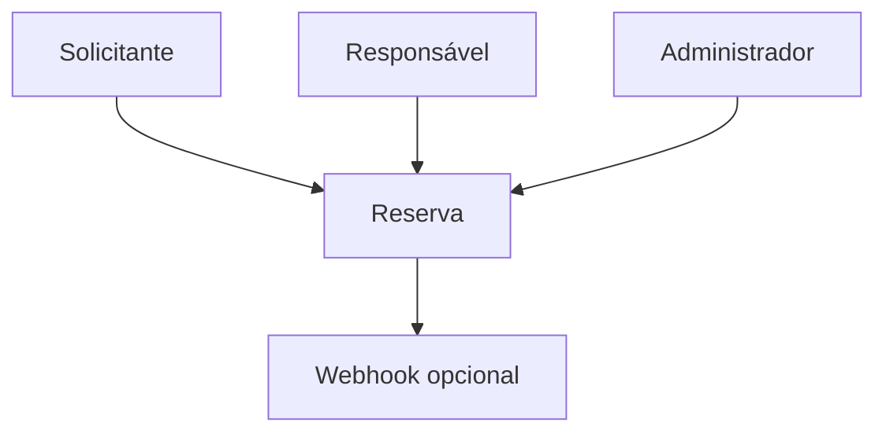
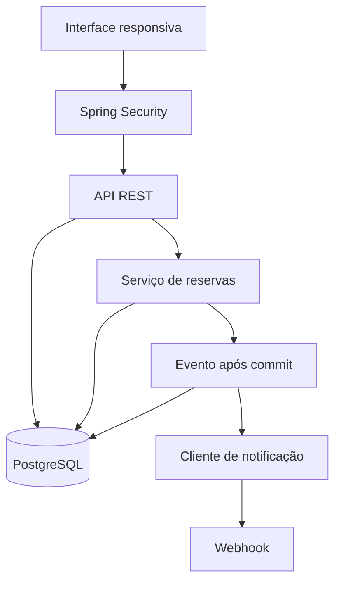
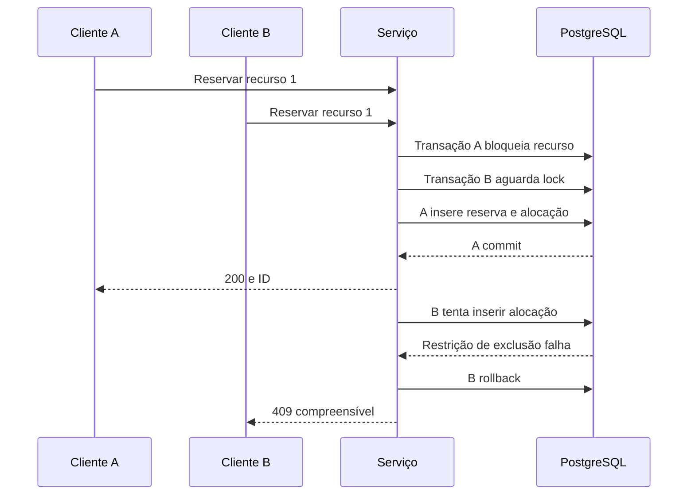
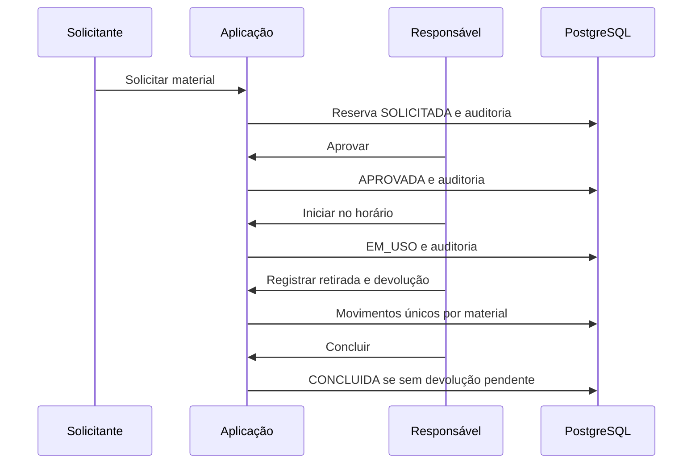

# Arquitetura, ATAM e decisões

## Contexto

Pessoas acessam a mesma aplicação por navegador. O webhook pertence à infraestrutura administrada pela equipe e recebe somente o identificador da reserva.

## Componentes

Monólito Spring Boot. Controller aplica validação e regras de acesso; BookingService concentra transações de reserva. PostgreSQL aplica integridade inclusive se duas requisições passarem pelas validações ao mesmo tempo. Migrações versionadas pelo Flyway.

## Sequência crítica: concorrência

Locks por recurso em ordem crescente reduzem deadlocks; a garantia final é a restrição `EXCLUDE USING gist` com `tstzrange(...,'[)')`. Reserva e alocações compartilham a mesma transação. Não usamos `synchronized` como garantia distribuída. O contador de conflito é persistido após o rollback pelo tratamento HTTP.

## Sequência crítica: material restrito

## Modelo

`app_user` identifica contas e perfis. `resource` representa sala, professor ou uma unidade de material. `booking` guarda proprietário, intervalo e estado. `allocation` liga múltiplos recursos à reserva e também guarda manutenção. `audit`, `notification`, `material_movement` e `avoided_conflict` registram evidências operacionais.

## Utility tree ATAM

| Atributo | Cenário mensurável | Prioridade / risco | Tática |
|---|---|---|---|
| Consistência | 50 pedidos iguais resultam em 1 aceito | Alta / alta | Exclusão no banco + transação |
| Autorização | Solicitante não aprova recurso restrito | Alta / alta | Perfil no servidor e testes negativos |
| Rastreabilidade | Toda transição produz autor, horário, origem e destino | Alta / média | Auditoria transacional |
| Desempenho | p95 de reserva < 2 s com 50 concorrentes | Média / alta | Índice GiST, locks ordenados; meta a medir |
| Robustez | Webhook 503 não apaga reserva | Média / média | Entrega após commit + status de falha |
| Manutenibilidade | Novas regras possuem regressão e RTM | Alta / média | JUnit, CI, documentação versionada |

Valores de carga e latência são metas iniciais propostas, não resultados medidos. Ajustar ao ambiente disponível e negociar com o professor.

## ADR-001 — PostgreSQL e restrição de exclusão

Decisão: PostgreSQL 16 com btree_gist; um intervalo por recurso/alocação. Alternativa rejeitada: consultar disponibilidade e inserir sem proteção do banco. Vantagem: atomicidade real sob concorrência. Custo: dependência de recurso específico do PostgreSQL e necessidade de ambiente real nos testes.

## ADR-002 — Monólito e interface na mesma origem

Decisão: frontend servido pelo Spring Boot, sessão e CSRF. Evita CORS e armazenamento de token no localStorage. Alternativa: SPA separada com JWT. Custo: escalabilidade horizontal precisaria de sessão compartilhada ou estratégia de afinidade.

## ADR-003 — Solicitação pendente ocupa a agenda

Decisão: SOLICITADA reserva o intervalo até decisão/cancelamento. Evita aprovar pedidos incompatíveis depois. Custo: pedidos esquecidos podem bloquear recursos; expiração automática fica como evolução.

## ADR-004 — Notificação simulada e webhook opcional

Decisão: persistir aviso na transação e tentar webhook após commit com timeout. Custo: queda do processo entre commit e entrega pode deixar SIMULADA, sem retry automático. Evolução: outbox com trabalhador e tentativas idempotentes.

## ADR-005 — Histórico preservado

Decisão: sem DELETE de reserva; cancelamento desativa alocação. Auditoria rejeita UPDATE/DELETE por trigger. Não equivale a imutabilidade contra o administrador do banco. Evolução: papel SQL restrito e exportação assinada.

## Fontes técnicas

- https://www.postgresql.org/docs/16/rangetypes.html
- https://www.postgresql.org/docs/16/sql-createtable.html
- https://docs.spring.io/spring-boot/3.5/system-requirements.html
- https://docs.spring.io/spring-security/reference/servlet/exploits/csrf.html

As decisões de negócio vieram do enunciado e das hipóteses de escopo explícitas em REGRAS.md.
