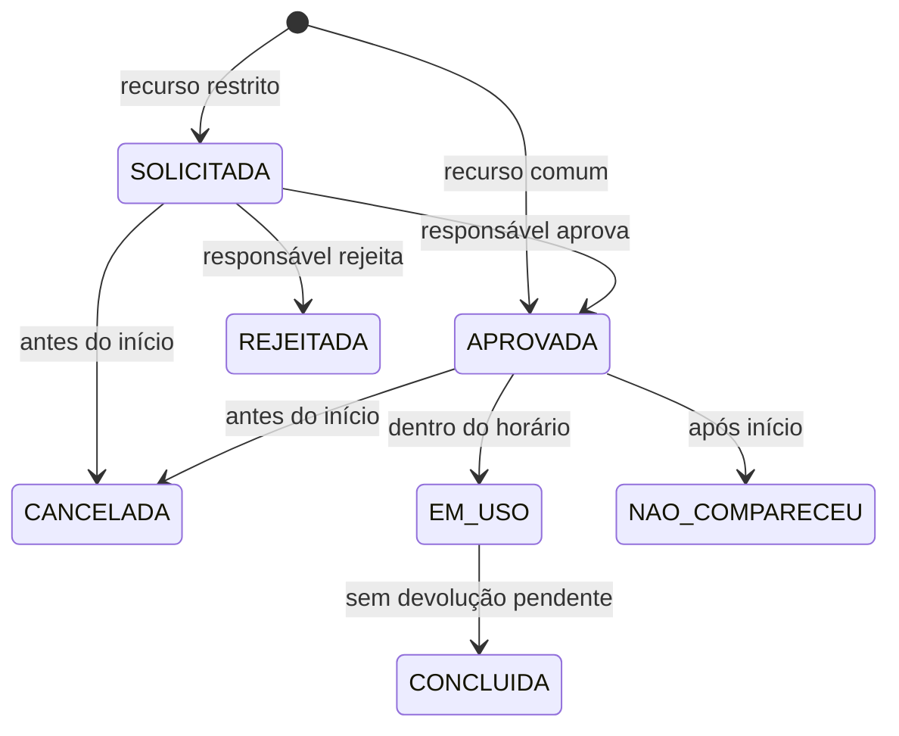

# Regras e permissões

| Operação | Solicitante | Responsável | Administrador |
|---|---|---|---|
| Consultar recursos e disponibilidade | Sim | Sim | Sim |
| Criar reserva própria | Sim | Sim | Sim |
| Alterar reserva própria futura | Sim | Sim | Sim |
| Ver reservas | Somente próprias | Todas | Todas |
| Cancelar reserva futura | Próprias | Todas | Próprias |
| Aprovar/rejeitar | Não | Sim | Não |
| Iniciar/concluir/ausência | Não | Sim | Não |
| Retirar/devolver material | Não | Sim | Não |
| Gerenciar recursos, usuários e manutenção | Não | Não | Sim |
| Auditoria e relatórios | Não | Sim | Sim |
| Notificações | Próprias | Próprias | Próprias |

## Invariantes

1. Fim estritamente posterior ao início; criação/alteração exige início futuro.
2. Uma reserva é atômica: se qualquer recurso conflitar, nada é salvo.
3. Intervalos são [início, fim), permitindo reservas adjacentes.
4. SOLICITADA, APROVADA, EM_USO e CONCLUIDA conservam sua ocupação histórica. Estados REJEITADA, CANCELADA e NAO_COMPARECEU liberam a alocação.
5. Manutenção/bloqueio usa a mesma tabela de alocação, com reserva nula.
6. Reservas iniciadas não podem ser alteradas nem canceladas; não existe endpoint DELETE de reservas.
7. Recursos com alocações ativas futuras não podem ter cadastro alterado. Evita mudar restrição ou tipo de um recurso já comprometido.
8. Retirada e devolução são únicas por material/reserva; devolução exige retirada; conclusão exige devolução dos materiais retirados.
9. Início de uso apenas dentro do horário reservado; ausência somente após início; aprovação somente antes do início.
10. Mudança de estado gera auditoria e notificação dentro da transação; falha de webhook não desfaz a reserva.
11. Recursos restritos exigem responsável mesmo quando a reserva foi criada por administrador. Alterações de recursos/horário/título refazem a aprovação.
12. Não há ajuste de quantidade: cada equipamento deve ser cadastrado individualmente.

## Estados

Uma alteração de reserva futura recalcula o estado inicial e é registrada como RESERVA_SALVA no histórico. Datas futuras aprovadas não se tornam automaticamente EM_USO.

## Limites de segurança

As credenciais do banco local são de desenvolvimento. Antes de exposição pública: usar TLS, credencial de aplicação com privilégios mínimos distinta da migração, cookie secure, backups, política de retenção e controle de tentativas de login no proxy. O Compose publica portas apenas em 127.0.0.1. Senhas nunca são retornadas na API ou gravadas na auditoria. Não existe cadastro público nem redefinição de senha nesta versão.

O trigger impede UPDATE/DELETE de auditoria pelo uso comum; um administrador do próprio banco ainda pode alterar esquema ou desabilitar triggers. Isso não é um sistema de auditoria inviolável contra DBA.
